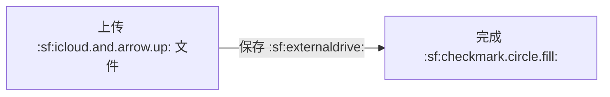
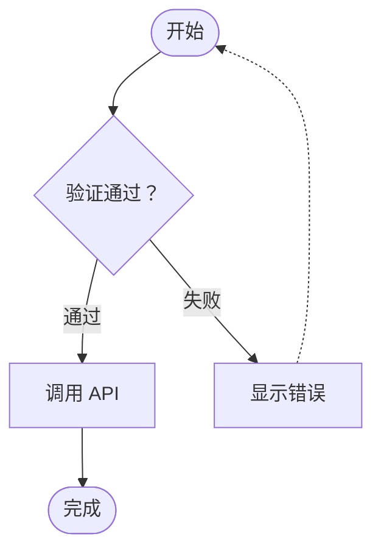
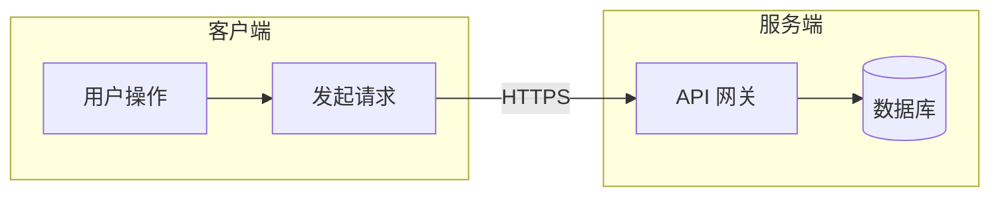

# Norna Studio

使用纯 Swift 实现的图表引擎，以及可运行的 macOS Mermaid 编辑器。

从解析、文本测量、分层布局到画布绘制，全部在原生侧执行。没有 JavaScriptCore、WKWebView、浏览器或运行时网络依赖。目前支持 33 类图形，每类都有基础语法、专用布局和可运行示例。图形种类覆盖不等于全部语法兼容，逐类范围和差异见 [支持矩阵](SUPPORT.md)。Swift 包名为 `Norna`，渲染库模块为 `NornaKit`，配套编辑器为 Norna Studio。第三方来源与许可见 [第三方声明](../THIRD_PARTY_NOTICES.md)。产品以图形类型覆盖、可读性和 Apple 平台体验为方向。

所有终端命令均在项目根目录执行。目录分工与提交约定见[开发指南](DEVELOPMENT.md)。

## 运行

要求 macOS 14 或更高版本。应用工程使用 Xcode 26 或更高版本编译原生分层图标，Swift Package 要求 Swift 6。工程和 Swift Package 均已提供，无须安装第三方依赖。

```sh
open Norna.xcodeproj
```

选择 NornaStudio scheme，点击运行。也可以在终端直接运行：

```sh
swift run NornaStudio
```

构建应用：

```sh
xcodebuild build \
  -project Norna.xcodeproj \
  -scheme NornaStudio \
  -configuration Debug \
  -destination 'platform=macOS' \
  -derivedDataPath build \
  CODE_SIGNING_ALLOWED=NO
```

产物位于 `build/Build/Products/Debug/Norna Studio.app`。修改 `project.yml` 后，可以使用 XcodeGen 重新生成工程；正常打开与编译不需要安装 XcodeGen。

## 使用

- 左侧按用途分组显示全部 33 类图形，可按中英文名称搜索；选择类型后载入可编辑的起始示例，中间编辑，右侧实时预览。
- 29 类可变布局图形在源码上方的横向滚动栏中提供“简单示例”和“复杂示例”，用于比较数据增加后的分层、分支、分区、图例和换行变化。象限图、Wardley 地图、Cynefin 框架和信息图保留单例；流程图、时序图、类图和状态图的原有专题示例继续保留。官网原始语料留作开发回归资料。
- 默认开启自适应布局，拖动分栏或调整窗口宽度会触发重新布局，可在工具栏的“显示”菜单关闭。
- 支持时序图、类图、状态图、实体关系图、数据图表、架构图、层级图、时间图等 33 类图形。
- 编辑后延迟 250 毫秒触发后台解析与布局，取消后的结果不会覆盖新源码。
- 草稿通过 UserDefaults 自动保存在本机，打开文件后编辑不会自动覆盖原文件。
- 画布默认跟随系统外观，也可在“显示”菜单中指定浅色或深色；支持系统的增加对比度设置，外观选择会保存在本机。
- 预览顶部依次提供“无主题色”“主题色”和“自定义”，默认使用主题色，之后保留本机保存的选择。选择“自定义”后直接打开系统颜色选择器，也可点击色块重新打开；颜色实时生效，并按浅色、深色和高对比度外观调整连线明度。切换配色保留布局、缩放、选择和线内标签位置；复制与各格式导出使用当前风格。
- 应用名称、窗口标题和菜单统一使用 Norna Studio，Dock 与 Finder 使用 Norna 的四节点图标。侧栏、选中按钮、输入焦点和图表主题共用靛蓝强调色，并适配系统浅色、深色和高对比度外观。
- 界面采用系统侧栏、工具栏、菜单、SF Symbols 和语义颜色；图表使用系统字体与动态系统调色板，默认隐藏网格，可按需开启。
- 工作台支持简体中文与英文，默认跟随系统语言。在工具栏的“显示”菜单中选择“语言”，可切换为“跟随系统”“简体中文”或“English”。选择会保存在本机，切换后立即生效；图表源码与草稿内容保留，侧栏搜索同时支持中英文名称。
- 拖动画布平移，触控板捏合或按住 Command 滚动缩放，双击适应画布。
- 点击节点或子图查看标识符与标签，画布获得焦点后可使用加号、减号和数字 0 控制视图。
- 支持打开文本格式的 Mermaid 文件、保存 `.mmd` 源码和复制 SVG。工具栏的“导出图表”或 Command + Shift + E 打开原生导出面板，支持 PNG、JPEG、TIFF、SVG 和 PDF。
- 语法错误显示行号并保留上一次成功的预览，修正后自动更新；预览未对应当前源码时禁用导出。

示例切换会替换当前草稿。需要保留内容时，请先使用 Command + S 保存文件。

## 内联 SF Symbols

在标签任意位置使用 `:sf:名称:`，名称来自系统 SF Symbols 图标库。



图标参与文本测量和自动换行，完整标记不会被拆开，支持显式换行和整行左对齐、居中及右对齐。单色图标使用文字的字号、字重与颜色，并采用系统提供的基线信息。此语法适用于可显示的标签文本，不用于标识符或数值字段。

图标可用性取决于渲染时的 macOS 版本，未知名称及不完整标记保留为源码文字。此写法是 Norna 扩展，其他 Mermaid 渲染器可能将其视为普通文字，不改变架构图已有的内置图标语法。

PNG、JPEG、TIFF 和 PDF 使用原生绘制导出图标。SVG 以 4 倍分辨率的透明 PNG 内嵌图标，文字和图形路径保留矢量形式，内嵌图标图片具有有限分辨率。导出文件不依赖外部图标文件或查看设备上的 SF Symbols 字体。

## 原生内联内容

标签可以混合 SF Symbols 与原生富文本。工作台提供“SF Symbols 多色”和“原生富文本”两个中英文内置示例。

### SF Symbols 多色

```text
:sf:cloud.sun.fill@monochrome:
:sf:cloud.sun.fill@hierarchical:
:sf:cloud.sun.fill@multicolor:
:sf:cloud.sun.fill@palette(#2563eb,#f59e0b):
```

原有 `:sf:名称:` 保持单色。层级模式使用当前文字颜色，多色模式保留图标原生颜色，调色板模式接受 1 至 3 个六位十六进制颜色，颜色之间不留空格。系统版本及图标本身决定可用模式；没有原生多色层级的图标使用单色。

### 原生富文本

支持 `[b]粗体[/b]`、`[i]斜体[/i]`、`[code]等宽[/code]`、`[u]下划线[/u]`、`[s]删除线[/s]` 和 `[color=#2563eb]颜色[/color]`，可以嵌套并跨行使用。未闭合、嵌套不匹配及不支持的标签保留原文。这是 Norna 的配对标签语法，不解释 HTML 或完整 Markdown。

图标标记整体换行，富文本自动换行后保留样式。显式换行和整行左对齐、居中、右对齐共用同一套测量与绘制数据。

PNG、JPEG、TIFF 和 PDF 共用原生绘制流程。SVG 保留文字和路径的矢量形式，将图标按标签逻辑尺寸的 4 倍分辨率内嵌为透明 PNG，内嵌图标具有有限分辨率。导出文件不依赖外部图标资源。

## 流程图语法

方向声明应独占一行，或使用分号分隔。



| 功能 | 支持范围 |
| --- | --- |
| 图表声明 | `flowchart`、`graph` |
| 方向 | `TD`、`TB`、`BT`、`LR`、`RL` |
| 节点标识符 | 字母、数字、中文、下划线 |
| 节点 | `A[矩形]`、`A(圆角)`、`A([起止])`、`A((圆形))`、`A{判断}`、`A[(数据库)]`、`A[[子程序]]` |
| 连线 | `-->`、`---`、`-.->`、`-.-`、`==>`、`===` |
| 连线标签 | `-->|标签|`、`-- 标签 -->`、`-. 标签 .->`、`== 标签 ==>` |
| 链式连接 | `A --> B --> C` |
| 节点集合 | `A & B --> C & D` |
| 文本 | 中文、emoji、双引号标签、`<br>`、`<br/>`、`<br />`、`\n` |
| 注释与分隔 | `%%` 注释、换行、分号 |
| 布局 | 分支、汇合、断开的节点、循环回边、自环、跨层连线 |
| 子图 | `subgraph ID[标题]`、`subgraph ID`、带空格或双引号的匿名标题、`end` |
| 子图方向 | 子图内使用 `direction TD`、`TB`、`BT`、`LR`、`RL`，未指定时继承父级方向 |
| 子图连线 | 节点间跨组连接、分组作为端点、分组声明之前的前向引用 |
| 子图结构 | 多级嵌套、空分组、同一父级内重新打开已有分组 |

当前上限为 50000 个 UTF-16 字符、200 个节点、500 条连线、64 个子图、16 层嵌套，以及每层布局中的 5000 个顶点。超限会明确报错。

流程图已支持双向、圆点与叉号端点、不可见连线，以及双圆、六边形、非对称、平行四边形与梯形节点。已有形状可使用 `A@{ shape: hex, label: "节点" }` 声明。暂不支持任意 Mermaid 样式、Markdown 富文本、HTML 标签样式、图标和点击指令。其他图形的语法见 [支持矩阵](SUPPORT.md)，每种图形均可直接从侧栏示例开始编辑。

子图先独立布局，再作为容器参与父级层级排列。每个子图保留自己的方向，跨组连线通过正交可见性网格避开节点、无关分组和标题，组内连线限定在共同父组内。连线端口分散排列，保留正交转折和圆角，不将错位节点强制改成斜线直连。同轴连接可自然保持直线。连线标签使用 12 点字号和 18 点行高，嵌在线条中，采用紧凑底衬，优先沿合适的线段避让节点、标题和其他标签。回路线在侧面通道畅通时从节点侧面进入，与正常入口分开；回路通道按标签宽度留距。标签在圆角之间的实际直线段上选位，并检查全部可见连线，减少文字底衬遮住其他连线的情况。

默认节点间距为 40，层间距为 48，分组左右及底部留白为 20，普通容器圆角为 8。字体使用系统字体，画布、文本、表面、边框和强调色解析自 AppKit 语义颜色，数据序列使用系统调色板。原生画布和 SVG 共用场景、主题及路径；SVG 导出时会固定当前外观的颜色，便于在其他软件中查看。

## 图表配色风格

`DiagramColorStyle` 与 `DiagramTheme` 分开设置。`.neutral` 保留现有配色，`.themed` 为系统外观使用 Norna 靛蓝强调色，`.custom` 通过 `DiagramAccentColor` 指定颜色，并按当前外观生成节点、边框及连线颜色。数据系列和源码中显式指定的颜色保留，避免配色切换改变数据含义。已有 `paper`、`midnight` 和 `ocean` 主题在主题色风格中使用各自的强调色。

```swift
let artifact = try await NativeDiagramRenderer().render(source)
let neutralSVG = artifact.themedSVG(.appleLight, colorStyle: .neutral)
let themedSVG = artifact.themedSVG(.appleLight, colorStyle: .themed)

// Draw in a flipped AppKit graphics context.
CoreGraphicsDiagramPainter.draw(artifact.scene, theme: .appleLight, colorStyle: .themed)
```

工作台默认使用 `.themed`，用户可以切换并保存风格与自定义颜色。原有绘制和 SVG 接口省略 `colorStyle` 时仍使用 `.neutral`，已有集成调用保持原有配色。三种风格共用相同场景，不重新解析或布局。

## 图表导出

导出完整图表，不包含工作台、网格、平移缩放状态或选中框。导出面板提供预览、背景、四周留白和实际输出尺寸，并在尺寸旁显示当前配置的文件大小。调整格式、倍率或质量后会重新计算；保存时复用已生成的文件数据。

| 格式 | 透明背景 | 尺寸与质量 |
| --- | --- | --- |
| PNG | 支持 | 无损，工作台支持 1 至 4 倍 |
| JPEG | 不支持 | 工作台支持 1 至 4 倍和 10％ 至 100％ 压缩质量 |
| TIFF | 支持 | LZW 无损压缩，工作台支持 1 至 4 倍 |
| SVG | 支持 | 矢量，不受位图倍率影响 |
| PDF | 支持 | 单页矢量，保留原生文字 |

透明背景仅移除画布底色，节点填充和线内文字底衬保留。JPEG 自动使用当前画布背景。所有格式固定导出时的配色，便于在其他软件中查看。位图限制为单边最多 16384 像素、总计最多 3200 万像素，超限时提示降低倍率或留白。

```swift
let accent = DiagramAccentColor(red: 38, green: 128, blue: 75)
let data = try DiagramExporter.data(
    for: artifact.scene,
    theme: .appleLight,
    colorStyle: .custom,
    customAccent: accent,
    options: .init(format: .png, background: .transparent, scale: 2, padding: 16)
)
try data.write(to: destination)
```

`DiagramExporter` 默认使用主题色。`outputSize` 可提前验证参数和读取实际尺寸，`preview` 提供限制分辨率的 PNG 预览。

## macOS 应用图标

应用工程使用 `Sources/NornaStudio/Resources/NornaSculpted.icon` 原生 Icon Composer 分层资源。前景使用用户选定的立体 N 原稿，保留曲线、四个端点、厚度和光泽，背景由系统绘制。原稿光照保留在图片图层中，系统再施加原生高光、折射及阴影。透明和染色模式使用自动材质，保留原稿的明暗层次。系统负责生成亮色、暗色、透明亮色、透明暗色、染色亮色和染色暗色外观，实际显示遵循 macOS 的桌面图标设置。

macOS 26 或更高版本使用原生 Liquid Glass 图标。旧版 macOS 保留系统编译的静态兼容图标；`swift run NornaStudio` 使用随包附带的静态 `Norna.icns`，原生多外观图标需运行 Xcode 构建的应用。

```sh
swift Scripts/render_app_icon.swift
```

该命令通过 Apple 的 `ictool` 生成六种外观预览和静态兼容图标，默认使用当前系统对应的 26 或 27 代材质，也可在命令末尾指定 `26` 或 `27`。预览位于 `build/Branding/macos-icon-appearances.png`。只用于构建和设计验证，不引入运行时依赖。

站点和小尺寸图标按场景独立制作。导航与文档使用曲线 N 的纯色 SVG，标签页使用在 16 像素网格设计的微型版，主屏幕图标保留系统裁切空间，站点分享使用横向封面。规范见 [图标使用规范](../Branding/README.md)。执行 `swift Scripts/build_brand_assets.swift` 和 `python3 Scripts/report_icon_system.py` 可生成完整资源包与可视化使用指南，不会修改原生 APP 图标。

布局由 Norna 原生引擎计算。复杂密集图中仍可能出现连线交叉和标签重叠，极端避障场景会明确报告布局错误。节点属于首次将其纳入分组的子图，在其他分组中引用该节点不会移动它。

子图示例：



## 架构

```text
Mermaid 源码
  → NativeDiagramRenderer → DiagramKind
      → 各类 Swift 解析器与语义模型
      → 各类专用布局与 CoreText 测量
  → DiagramScene
      → 节点、分组、连线、通用矢量元素
      → CoreGraphicsDiagramPainter → AppKit NSView
      → SVGExporter → 自包含 SVG
```

流程图使用分层与复合布局，连线采用带圆角的正交折线并进行障碍避让；时序图按参与者和事件顺序排列，甘特图按日期定位，桑基图按流量确定带宽，铁路图按语法树组合轨道。各图形没有经过 SVG 再由浏览器绘制的过程。

`ScenePrimitive` 支持矩形、椭圆、贝塞尔路径和带样式的文本。原生画布与 SVG 共用几何数据、主题和文字换行。`NativeFlowchartRenderer` 保留为流程图专用兼容接口。

`NornaKit` 可以独立集成：

```swift
import NornaKit

let renderer = NativeDiagramRenderer()
let artifact = try await renderer.render(
    "flowchart LR\n A[源码] --> B[原生图表]",
    options: DiagramLayoutOptions(maxWidth: 360)
)
let svg = artifact.themedSVG(.appleLight)
let scene = artifact.scene
```

流程图的扩展节点与端点、时序图的生命周期和参与者类型、类图的接口与基数、状态图的并发区域均通过同一原生场景输出，示例见 `Sources/NornaKit/Examples/AdvancedDiagramExamples.swift`。

`DiagramExporter` 使用同一画布绘制器输出 PNG、JPEG、TIFF 和矢量 PDF，SVG 直接输出同一场景几何。

## 验证

```sh
swift test
```

测试逐类渲染全部 74 个示例，验证所有主题的 SVG XML、有限几何边界和原生 PNG 输出；另外逐类验证 33 个起始示例在浅色、深色及两种高对比度外观中的原生绘制、系统符号和文字对比度，并检查时序控制片段、甘特依赖、架构端口、层级节点间距、铁路分支及非法输入。原有测试继续覆盖基础流程图形状、四个方向、循环与自环、跨层通道、节点不重叠、中文与带引号标签、非法输入、XML 转义和主题导出；子图测试还覆盖层级包含关系、独立方向组合、分组端点、空分组、前向引用、标题避障及标签分离。

参考：[Pele 流程图参数](https://github.com/obsidianmd/pele/blob/main/src/diagrams/flowchart/render.ts)、[节点测量](https://github.com/obsidianmd/pele/blob/main/src/svg/shapes.ts)、[复合布局](https://github.com/obsidianmd/pele/blob/main/src/layout/compound.ts)。本项目不运行上游 TypeScript 或 JavaScript。

需要生成视觉检查文件时：

```sh
NORNA_FIXTURE_DIR=/tmp/norna-native-fixtures swift test
```

默认外观参考 Apple 的[颜色规范](https://developer.apple.com/design/human-interface-guidelines/color)、[字体规范](https://developer.apple.com/design/human-interface-guidelines/typography)和[侧栏规范](https://developer.apple.com/design/human-interface-guidelines/sidebars)。保留 `paper`、`midnight` 和 `ocean` 供已有集成调用，编辑器默认使用系统外观。日期图、流量图、时序图和关系图使用各自的几何布局。

生成四种系统外观的逐类预览：

```sh
NORNA_APPLE_FIXTURE_DIR=build/ApplePreviews swift test
python3 Scripts/report_native_previews.py
```

打开 `build/ApplePreviews/index.html` 可并排比较简单与复杂示例，统一切换四种系统外观和两种配色风格，并查看对应 SVG 和源码。复杂示例额外检查 320、640 和 1200 点三种容器宽度。这是本地开发预览，应用运行时不使用 HTML 或 JavaScript。

全部内置示例的连线回归和三种宽度预览：

```sh
NORNA_CONNECTOR_AUDIT_DIR=build/ConnectorAudit swift test --filter ConnectorAuditTests
python3 Scripts/report_connector_audit.py
```

打开 `build/ConnectorAudit/index.html` 可检查 33 类图形的全部 74 个内置示例，并切换 320、640 和 1200 点布局宽度。关系连线自动检查可省略的同轴绕行、共线段重叠、节点遮挡，以及线内标签与其他连线的冲突。目录主干、铁路汇合、桑基流带和数据坐标轴保留各自语义。带显式方位端口的架构图保留端口方向，窄窗口允许平移查看，避免自动换向带来的折返。

图表画布支持缩放与平移，但尚未实现完整的图元无障碍导航或用户字号缩放。密集图形仍可能缩小文字或出现交叉，详情见 [支持矩阵](SUPPORT.md)。

复杂语法的四种外观预览：

```sh
NORNA_COMPLEX_FIXTURE_DIR=build/ComplexPreviews swift test
python3 Scripts/report_native_previews.py build/ComplexPreviews
```

输出为 `build/ComplexPreviews/index.html`。

## 开发回归资料与自适应布局

官网总览和 32 个详情页已保存到 `Baselines/OfficialSources`，659 次展示去重为 600 份源码；来源、位置和 SHA-256 存于资源清单。另存有官网现成的 852 份 SVG，全部来自静态 HTML，没有执行上游 JavaScript。

[逐类结果](../Baselines/REPORT.md)与[逐例图像对照](../Baselines/report.html)记录自然宽度和 320、480、640 点容器下的结果。当前快照为 304 份可生成，另有 296 份待支持。测试验证结构和语法回归，图像对照中的已保存产物反映生成报告时的外观；它们不作为当前 Apple 外观的视觉验收标准。语法覆盖仍需逐步补齐。

`DiagramLayoutOptions` 提供 `maxWidth`、`autoDirection` 和 `directionBreakpoint`。横向流程图及部分关系图可选择更窄的纵向布局，保留子图显式方向；时序图调整参与者间距和消息换行；时间线与旅程图可纵向排列；饼图、看板、雷达图和坐标图重排图例或栏目；甘特图调整绘图区与刻度。布局不通过整体缩放来代替重排，画布另保留缩放和平移。

并非所有图形都能适应任意宽度。数据过密、参与者过多、子图固定方向或图形尚未接入宽度参数时，实际宽度可以超过 `maxWidth`。流程图与时序图会缓存最近一次的语义模型，其他图形在宽度变化时仍重新解析。

更新官网快照及生成报告：

```sh
python3 Scripts/fetch_official_examples.py
python3 Scripts/fetch_official_references.py
NORNA_BASELINE_OUTPUT=/tmp/official-results.json \
NORNA_LAYOUT_OUTPUT=/tmp/official-layout-results.json \
NORNA_OFFICIAL_SVG_DIR=Baselines/NativeOutput swift test
```

核对测试输出后，将两份 JSON 更新到 `Baselines`，同步 `Sources/NornaKit/Resources/official-status.json`，再运行 `python3 Scripts/report_official_examples.py`。快照数量变化需要同时更新完整性测试，避免静默减少基准范围。
