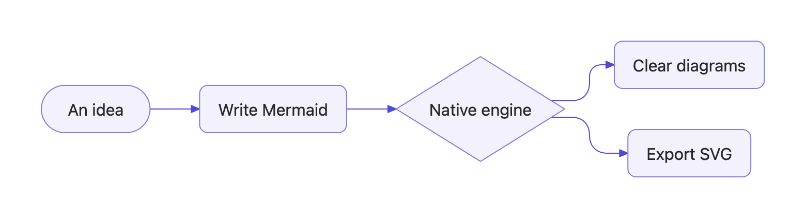

# Norna

[English](README.md) · [简体中文](README.zh-CN.md)

[](https://github.com/dufu1991/norna/actions/workflows/ci.yml)

**Native diagrams, clearly.**

Norna is a pure Swift diagram engine and a native Mac workbench for Mermaid source. Parsing, text measurement, layout, rendering, and export run natively, without a browser, JavaScript runtime, or network service.

- **NornaKit** is the rendering library for integration into macOS apps.
- **Norna Studio** is the companion editor for writing, previewing, and exporting diagrams.



## Features

- 33 diagram families, including flowcharts, sequence, class, state, ER, Gantt, mind maps, and data charts.
- Live previews, adaptive layouts, canvas pan and zoom, and source error locations.
- English and Simplified Chinese interfaces and examples.
- System light, dark, and increased contrast appearances, with configurable diagram colors.
- Inline SF Symbols and native rich text extensions.
- PNG, JPEG, TIFF, SVG, and PDF export.

Syntax support varies by diagram family. See the [support matrix, in Chinese](Docs/SUPPORT.md) for supported constructs and current limits. Norna does not claim complete Mermaid compatibility.

## Download Norna Studio

Requires **macOS 14 or later**. The universal app supports **Apple Silicon and Intel Macs**.

[Download DMG](https://github.com/dufu1991/norna/releases/latest/download/Norna-Studio-macOS-universal.dmg) · [Download ZIP](https://github.com/dufu1991/norna/releases/latest/download/Norna-Studio-macOS-universal.zip) · [All releases](https://github.com/dufu1991/norna/releases)

Packages become available after the first successful Studio release workflow. Open the DMG and drag **Norna Studio** into **Applications**, or extract the ZIP and move the app there. Each release includes SHA-256 checksums and a `release.json` manifest.

Release notes identify the signing status. Until Apple credentials are configured, packages are **ad-hoc signed and not notarized**; macOS Gatekeeper may block them. Developer ID signing and notarization can be enabled in repository settings. See the [release guide](Docs/RELEASING.md).

## Build from source

Use **Xcode 26 or later** for the complete app, or a **Swift 6** toolchain for the Swift package. No external package dependencies are required.

```sh
git clone https://github.com/dufu1991/norna.git
cd norna
open Norna.xcodeproj
```

Select the `NornaStudio` scheme and run, or launch the package executable:

```sh
swift run NornaStudio
```

The Xcode app uses the native layered icon. The package executable uses its bundled static icon.

Run the tests:

```sh
swift test
python3 -m unittest discover -s Tests/ReleaseTests -p 'test_*.py'
```

Build a local universal DMG and ZIP:

```sh
bash Scripts/Release/package.sh
```

Packages are written to `build/release/`. This command builds and packages the app without launching it or publishing a release.

## Use NornaKit

Add this repository as a Swift Package dependency and link the **NornaKit** product. Until a library version tag is published, use `main` or pin a specific commit:

```swift
.package(url: "https://github.com/dufu1991/norna.git", branch: "main")
```

```swift
import NornaKit

let diagram = try await NativeDiagramRenderer().render(
    "flowchart LR\n A[Source] --> B[Native diagram]",
    options: DiagramLayoutOptions(maxWidth: 640)
)
let svg = diagram.themedSVG(.appleLight)
```

`diagram.scene` contains the native geometry. `CoreGraphicsDiagramPainter` draws into an AppKit graphics context, and `DiagramExporter` handles image and PDF output. More examples and extensions are documented in the [Chinese usage guide](Docs/GUIDE.md).

## CI and releases

| Event | Result |
| --- | --- |
| Push to `main` or PR targeting `main` | Tests, universal Release build, and website resource checks |
| Change `Configuration/Studio-Version.xcconfig` on `main` | After checks pass, package and publish `studio-vX.Y.Z` |
| Manual workflow on `main`, with `release` enabled | Publish the current Studio version, or recover a failed draft |
| Push a library tag such as `vX.Y.Z` | Does not publish the Studio app |

**Studio and NornaKit have independent versions.** Change `MARKETING_VERSION` and increment `CURRENT_PROJECT_VERSION` in the Studio version file to release the app. This also applies to the initial push containing that file. Ordinary commits do not create a new Release; published Studio versions are immutable. See [release setup and recovery](Docs/RELEASING.md).

## Repository layout

```text
Sources/NornaKit/       Models, parsing, layouts, rendering, export, and examples
Sources/NornaStudio/    Native app, editor, canvas, export UI, and localization
Tests/                 Swift tests and release automation tests
Baselines/             Versioned reference sources, SVGs, and regression snapshots
Configuration/         App metadata, entitlements, and Studio version
Scripts/               Development tools and release packaging
Branding/              Brand source assets and usage rules
Docs/                  Usage, support, development, and release documentation
website/               Static website, published assets, and generation tools
.github/workflows/     CI and automatic Studio releases
```

`Package.swift` defines the package. `project.yml` defines the XcodeGen project; `Norna.xcodeproj` is committed for direct use. After changing the project definition or adding, removing, or moving source files, run `xcodegen generate`. Editing the Studio version file does not require regeneration.

Build output and local design archives are excluded from Git. App and website sources share this repository. See the [development guide, in Chinese](Docs/DEVELOPMENT.md), [website guide, in Chinese](website/README.md), and [brand guide, in Chinese](Branding/README.md).

## Attribution

Norna adapts selected measurement formulas, rendering conventions, and reference examples from Pele. See [third-party notices](THIRD_PARTY_NOTICES.md) and the licenses in the library resources. Norna's original code is distributed under the [MIT License](LICENSE).
