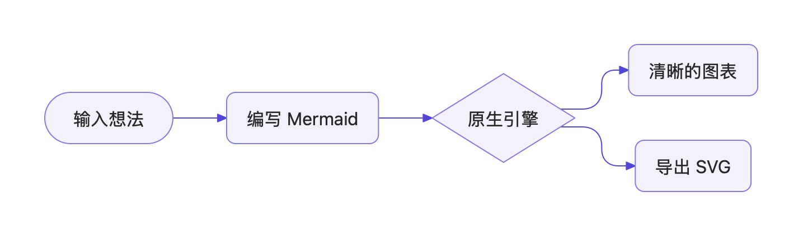
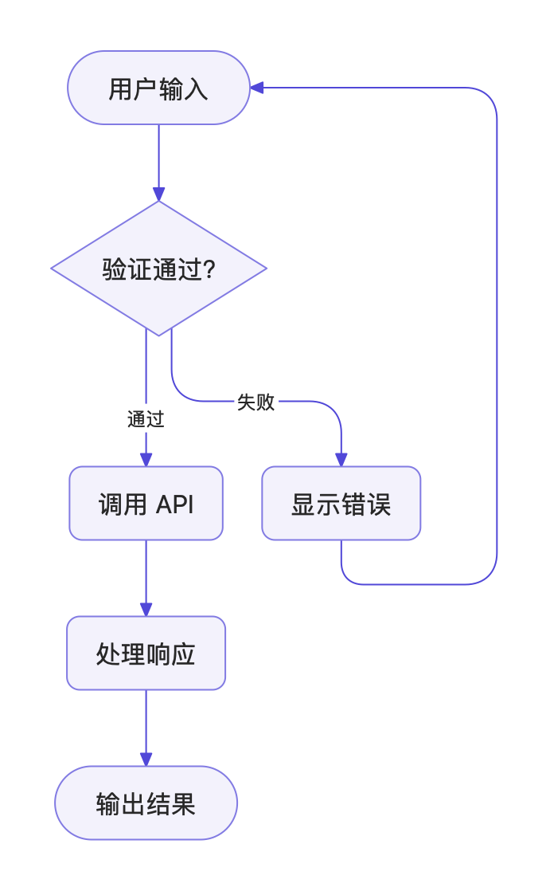
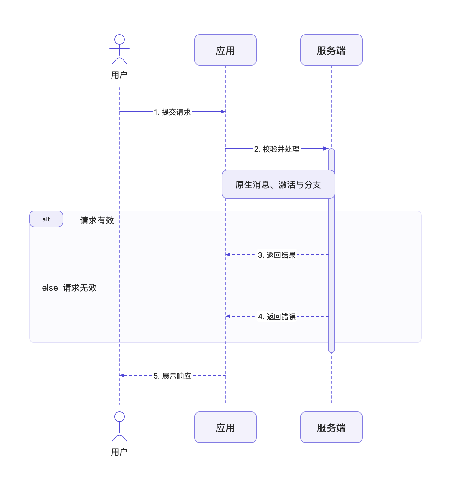
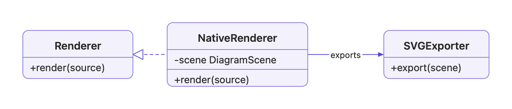
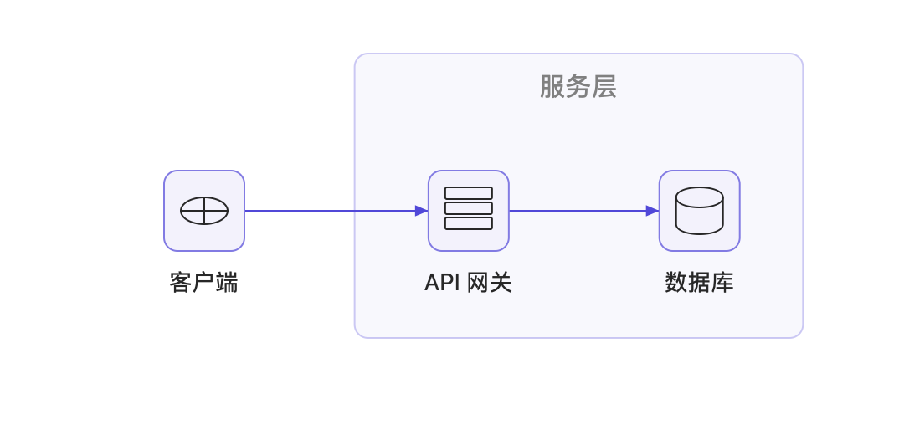
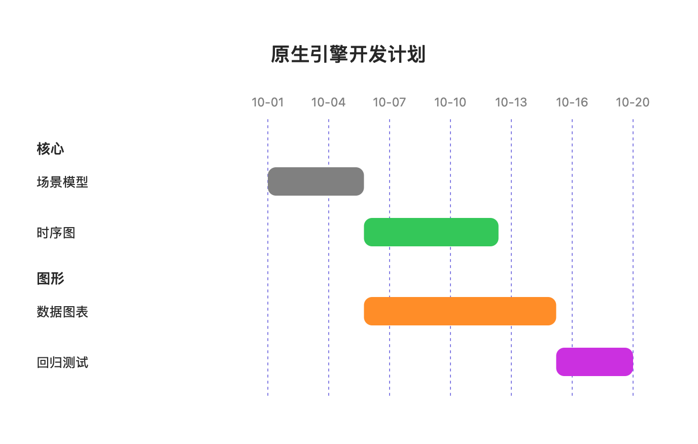
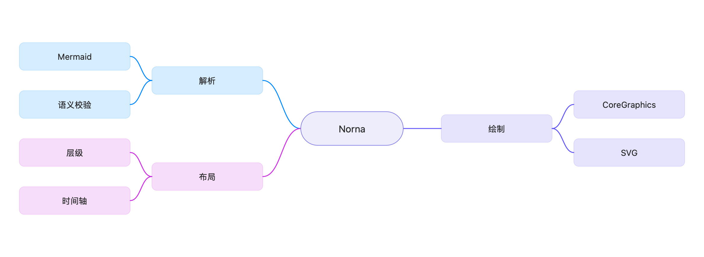

# NornaKit

[English](README.md) · [简体中文](README.zh-CN.md)

[](https://github.com/dufu1991/nornakit/actions/workflows/ci.yml)

**让思路，清晰成形。**

[https://nornakit.com](https://nornakit.com)

**NornaKit** 是面向 macOS 与 Windows 的原生 Mermaid 图表渲染库。macOS 使用 Swift 与 CoreGraphics，Windows 使用 C#、.NET 10、DirectWrite 与 Win2D。解析、文本测量、布局、绘制和导出均在本地原生侧完成，无须浏览器、JavaScript 运行时或网络服务。

- **NornaKit** 提供解析、布局、原生绘制与导出能力，是本项目的主要内容。
- **Norna Studio** 是配套的原生演示与开发工具。macOS 使用 SwiftUI，Windows 使用 WinUI 3。集成任一平台的渲染库均无须安装工作台。

<picture>
  <source media="(prefers-color-scheme: dark)" srcset="website/dist/assets/hero-zh-dark.png">
  <source media="(prefers-color-scheme: light)" srcset="website/dist/assets/hero-zh-light.png">
  
</picture>

## 集成 macOS 版 NornaKit

要求 **macOS 14 或更高版本**、**Swift 6**，没有外部包依赖。

将本仓库添加为 Swift Package 依赖，链接 **NornaKit** 产品。在渲染库版本标签发布前，使用 `main` 分支或固定到具体提交：

```swift
.package(url: "https://github.com/dufu1991/nornakit.git", branch: "main")
```

```swift
import NornaKit

let diagram = try await NativeDiagramRenderer().render(
    "flowchart LR\n A[源码] --> B[原生图表]",
    options: DiagramLayoutOptions(maxWidth: 640)
)
let svg = diagram.themedSVG(.appleLight)
```

`diagram.scene` 包含原生几何。`CoreGraphicsDiagramPainter` 可将场景绘制到 AppKit 图形上下文，`DiagramExporter` 负责图像与 PDF 导出。详细用法与扩展语法见[使用指南](Docs/GUIDE.md)。

## 功能

### Windows 接入

[`Windows/`](Windows/README.md) 解决方案包含独立的 `NornaKit.Core`、`NornaKit.Windows` 库，以及 WinUI 3 工作台。支持 Windows 11 初始版本及以上的 x64 和 ARM64，构建使用 Windows SDK 26100。

```csharp
using NornaKit;
using NornaKit.Windows;

var renderer = WindowsDiagramRenderer.Create();
var diagram = await renderer.RenderAsync(
    "flowchart LR\n A[源码] --> B[原生图表]",
    new DiagramLayoutOptions(MaxWidth: 640), cancellationToken);
var svg = SvgExporter.Export(diagram.Scene, WindowsPalette.Resolve());
```

NuGet 包发布前通过项目引用接入。解析、布局与离屏导出无须创建可见窗口，可按需使用 `DiagramPreview` 原生预览控件。完整接入、平台差异与打包说明见 [Windows 指南](Docs/WINDOWS.md)。Windows 下载入口在实际发布安装包后启用。

### 共同能力

- 支持 33 类图形，覆盖流程图、时序图、类图、状态图、实体关系图、甘特图、思维导图与数据图表。
- Mermaid 源码解析、原生文本测量、自适应布局与源码错误定位。
- 可供宿主应用绘制的原生场景几何，以及中英文示例源码。
- 系统浅色、深色与高对比度外观，以及可配置的图表配色。
- 内联 SF Symbols 与原生富文本扩展。
- PNG、JPEG、TIFF、SVG 和 PDF 导出。

各类图形的语法支持程度不同，具体范围与限制见[支持矩阵](Docs/SUPPORT.md)。项目不宣称完整兼容 Mermaid 的全部语法。

## 渲染示例

精选几种常用图表，均由 NornaKit 原生渲染。图片随浅深色外观切换，点击可查看原图。

<table>
  <tr>
    <td align="center" valign="top" width="50%">
      <strong>流程图</strong><br>
      <a href="website/dist/assets/flowchart-zh-light.png">
        <picture>
          <source media="(prefers-color-scheme: dark)" srcset="website/dist/assets/flowchart-zh-dark.png">
          
        </picture>
      </a><br>
      <a href="website/dist/assets/flowchart-zh.mmd">Mermaid 源码</a>
    </td>
    <td align="center" valign="top" width="50%">
      <strong>时序图</strong><br>
      <a href="website/dist/assets/sequence-zh-light.png">
        <picture>
          <source media="(prefers-color-scheme: dark)" srcset="website/dist/assets/sequence-zh-dark.png">
          
        </picture>
      </a><br>
      <a href="website/dist/assets/sequence-zh.mmd">Mermaid 源码</a>
    </td>
  </tr>
  <tr>
    <td align="center" valign="top" width="50%">
      <strong>类图</strong><br>
      <a href="website/dist/assets/class-zh-light.png">
        <picture>
          <source media="(prefers-color-scheme: dark)" srcset="website/dist/assets/class-zh-dark.png">
          
        </picture>
      </a><br>
      <a href="website/dist/assets/class-zh.mmd">Mermaid 源码</a>
    </td>
    <td align="center" valign="top" width="50%">
      <strong>架构图</strong><br>
      <a href="website/dist/assets/architecture-zh-light.png">
        <picture>
          <source media="(prefers-color-scheme: dark)" srcset="website/dist/assets/architecture-zh-dark.png">
          
        </picture>
      </a><br>
      <a href="website/dist/assets/architecture-zh.mmd">Mermaid 源码</a>
    </td>
  </tr>
  <tr>
    <td align="center" valign="top" width="50%">
      <strong>甘特图</strong><br>
      <a href="website/dist/assets/gantt-zh-light.png">
        <picture>
          <source media="(prefers-color-scheme: dark)" srcset="website/dist/assets/gantt-zh-dark.png">
          
        </picture>
      </a><br>
      <a href="website/dist/assets/gantt-zh.mmd">Mermaid 源码</a>
    </td>
    <td align="center" valign="top" width="50%">
      <strong>思维导图</strong><br>
      <a href="website/dist/assets/mindmap-zh-light.png">
        <picture>
          <source media="(prefers-color-scheme: dark)" srcset="website/dist/assets/mindmap-zh-dark.png">
          
        </picture>
      </a><br>
      <a href="website/dist/assets/mindmap-zh.mmd">Mermaid 源码</a>
    </td>
  </tr>
</table>

[浏览全部示例](https://nornakit.com/#examples)

## 开发与验证

```sh
git clone https://github.com/dufu1991/nornakit.git
cd nornakit
swift build --target NornaKit
swift test
```

库源码位于 `Sources/NornaKit/`，测试与回归资料分别位于 `Tests/NornaKitTests/` 和 `Baselines/`。目录约定与开发命令见[开发指南](Docs/DEVELOPMENT.md)。

## 配套工具：Norna Studio

Norna Studio 调用同一套 NornaKit API，用于演示库能力、复现和调试渲染问题，以及临时将 Mermaid 源码渲染并导出为图片、SVG 或 PDF。工作台提供源码编辑、实时预览、画布平移缩放与中英文界面。

### 下载与运行

要求 **macOS 14 或更高版本**。仅支持 **Apple Silicon Mac**。

[下载 DMG](https://github.com/dufu1991/nornakit/releases/latest/download/Norna-Studio-macOS-arm64.dmg) · [下载 ZIP](https://github.com/dufu1991/nornakit/releases/latest/download/Norna-Studio-macOS-arm64.zip) · [全部版本](https://github.com/dufu1991/nornakit/releases)

首次工作台发布流程成功后，下载链接才会生效。打开 DMG，将 **Norna Studio** 拖入 **Applications**，或解压 ZIP 后移动应用。每个版本均附带 SHA-256 校验和与 `release.json` 清单。

发布说明会标明签名状态。在仓库配置 Apple 凭据前，软件包使用**临时签名，未经 Apple 公证**，可能被 macOS Gatekeeper 拦截。可在仓库设置中启用 Developer ID 签名与公证，步骤见[发布指南](Docs/RELEASING.md)。

### 通过 Homebrew 安装

配套工作台也通过个人 [dufu1991/tap](https://github.com/dufu1991/homebrew-tap) 仓库中的 Cask 分发：

```sh
brew install --cask dufu1991/tap/norna-studio
```

更新命令：

```sh
brew update
brew upgrade --cask dufu1991/tap/norna-studio
```

Norna Studio 的 Cask 发布到 tap 后，上述命令才会生效。Homebrew 安装的是 GitHub Releases 中的同一份应用，签名状态相同。NornaKit 渲染库仍通过 Swift Package Manager 集成。

### 从源码运行

完整应用要求 **Xcode 27.1 或更高版本**。打开工程并选择 `NornaStudio` scheme 运行：

```sh
open NornaKit.xcodeproj
```

也可以使用 Swift Package 启动配套工具：

```sh
swift run NornaStudio
```

Xcode 应用使用原生分层图标，Swift Package 可执行程序使用随包分发的静态图标。工作台运行与调试说明见[使用指南](Docs/GUIDE.md)。

### 打包配套工具

```sh
python3 -m unittest discover -s Tests/ReleaseTests -p 'test_*.py'
bash Scripts/Release/package.sh
```

Apple Silicon 版 DMG 和 ZIP 位于 `build/release/`。打包命令不启动工作台，也不发布到 GitHub。

## CI 与版本发布

| 时机 | 自动执行 |
| --- | --- |
| 推送到 `main`，或向 `main` 提交 PR | 测试、Apple Silicon 版 Release 构建与网站资源校验 |
| `main` 中的 `Configuration/Studio-Version.xcconfig` 发生变化 | 检查通过后打包，发布 `studio-vX.Y.Z` |
| 在 `main` 手动运行工作流，并开启 `release` | 发布当前工作台版本，或恢复失败的发布草稿 |
| 工作台 Release 成功，且已配置 `HOMEBREW_TAP_TOKEN` | 立即更新 `dufu1991/homebrew-tap` 中的 Cask |
| tap 仓库每小时执行，或手动运行同步工作流 | 校验最新工作台 Release 并同步 Cask，无须个人令牌 |
| 推送渲染库的 `vX.Y.Z` 标签 | 不发布工作台应用 |

**NornaKit 是主要的库产品，工作台独立维护版本。** 发布工作台时，修改版本文件中的 `MARKETING_VERSION`，并递增 `CURRENT_PROJECT_VERSION`。包含该文件的首次推送也会触发发布。普通提交不创建新 Release，已发布的工作台版本不会被覆盖。配置和重试方式见[发布指南](Docs/RELEASING.md)。

## 目录结构

```text
Sources/NornaKit/       模型、解析、布局、绘制、导出与示例
Sources/NornaStudio/    原生应用、编辑器、画布、导出界面与本地化
Tests/                 Swift 测试与发布自动化测试
Baselines/             版本化参考源码、SVG 与回归快照
Configuration/         应用元数据、权限与工作台版本
Scripts/               开发工具与发布打包脚本
Branding/              品牌源文件与规范
Docs/                  使用、支持、开发与发布文档
website/               静态网站、发布资源与生成工具
.github/workflows/     CI 与工作台自动发布
```

`Package.swift` 定义 Swift Package，`project.yml` 定义 XcodeGen 工程。生成的 `NornaKit.xcodeproj` 一并提交，便于直接使用。修改工程定义或增删、移动源码后，执行 `xcodegen generate`。单独修改工作台版本文件不需要重新生成工程。

构建产物和本地设计归档已从 Git 排除。应用与网站共用本仓库。另见[开发指南](Docs/DEVELOPMENT.md)、[网站说明](website/README.md)和[品牌规范](Branding/README.md)。

## 致谢

部分测量公式、绘制约定与参考示例改编自 Pele。来源和许可见[第三方声明](THIRD_PARTY_NOTICES.md)及库资源中的许可文件。项目原创代码采用 [MIT 许可](LICENSE)。
